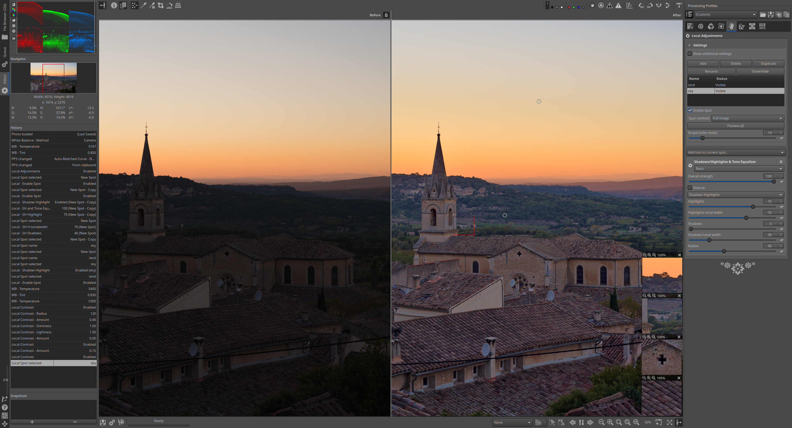
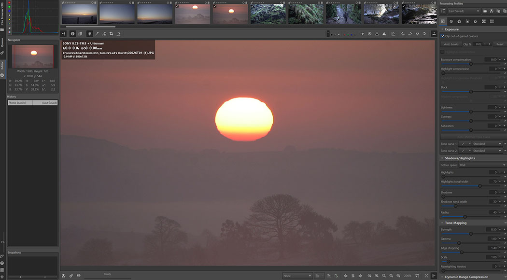

# RawTherapee Develops RAW Photos Through Reusable Processing Profiles

Keep the camera original, the editing decisions, and the exported photograph as separate parts of the same job. The rawtherapee open source project provides a non-destructive RAW processor for refining color, tone, and detail while retaining the source image.

[](https://rawtherapee-open-source.github.io/rawtherapee-photo-editing/)

## Preserve the Decisions Alongside the Photograph

A RAW file contains camera data; a processing profile records how RawTherapee should develop it. The exported JPEG, TIFF, or PNG is a rendered result of those choices.

For rawtherapee photo editing, keep the original and its PP3 sidecar together when moving a job between folders or backing it up.

- Retain the camera file as the source for future versions.
- Preserve the processing profile used for a finished export.
- Give alternate edits recognizable profile or output names.
- Keep exports in a location that makes their intended use clear.

A sidecar normally follows the source filename: an image named capture.nef can have a sidecar named capture.nef.pp3. The supplied [rawtherapee.1](doc/manpage/rawtherapee.1) documents this convention and the command-line profile options.

### Separate a Starting Profile from an Image-Specific Edit

A reusable profile can establish a starting point, while a sidecar stores decisions for one photograph. Recheck white balance, exposure, and crop when applying settings to a different scene.

A partial PP3 profile can contain only selected settings. This illustrative INI fragment disables automatic exposure and histogram matching:

```ini
[Exposure]
Auto=false
HistogramMatching=false
```

These keys are present in the upstream [processing profiles](https://github.com/RawTherapee/RawTherapee/tree/dev/rtdata/profiles). The fragment is a small override, not a complete photographic look or a supplied local file.

The developer note [how-to-add-processing-tool.md](devnotes/how-to-add-processing-tool.md) explains how processing parameters are represented and serialized into PP3 files.

## Balance Tone Before Judging Fine Detail

Use a rawtherapee raw editing workflow that separates broad image decisions from close inspection. Establish the intended brightness and color balance before making small texture changes.

Review the histogram alongside the preview. A brighter image is not necessarily a better rendering of highlights, and lifting shadows can make noise more apparent.

### Make a Representative Edit

1. Choose a photograph that represents the lighting and subject of the series.
2. Establish white balance and the overall tonal direction.
3. Check bright regions and important shadow detail.
4. Adjust crop and geometry for the intended composition.
5. Inspect texture before applying the same settings to related images.



Use comparisons to identify what each adjustment changes. Avoid judging a new setting solely from a thumbnail when its effect concerns fine detail.

## Inspect the RAW Conversion Where It Matters

The rawtherapee raw converter provides demosaicing and correction tools for turning sensor data into a viewable photograph. Camera support and processing choices affect the result before final sharpening.

- Inspect fine edges and repeating patterns when evaluating demosaicing.
- Check dark regions separately from well-exposed areas when reducing noise.
- Use dark-frame or flat-field corrections when suitable reference data is available.
- Review pixel-shift results for movement-related problems in the scene.

Judge noise reduction and sharpening together at a useful detail magnification, then return to the full composition. A clean enlarged patch can still look unnatural in the finished photograph.

When investigating slow processing, [profiling.md](devnotes/profiling.md) describes developer profiling methods. Those measurements concern execution performance rather than photographic quality.

## Choose the File You Need to Deliver

Rawtherapee non-destructive editing preserves the ability to render another version from the original and its profile. Select the export format for the next use of that version.

| Intended delivery | Format | CLI selection | Practical implication |
| --- | --- | --- | --- |
| Everyday review or sharing | JPEG | -j92 | Lossy compression; eight bits per channel |
| Further editing | TIFF | -t -b16 | Sixteen-bit output retains more tonal precision |
| Lossless rendered image | PNG | -n -b16 | Lossless compression with sixteen-bit output |
| Repeatable future rendering | Original plus PP3 | Preserve both | Keeps source data and processing decisions |

Bit depth does not replace choosing the appropriate output color profile. Check the export in the application or viewing environment where it will be used.

### Render One Reviewed Photograph

With RawTherapee CLI installed and an existing capture.nef plus its sidecar available, this Bash example creates a JPEG review file:

```bash
rawtherapee-cli -o review.jpg \
  -s -j92 \
  -c capture.nef
```

The -s option reads the sidecar when it exists. If it is missing, neutral values are used, so confirm the expected profile before interpreting the export.

The input selector -c must be the final option. Change filenames for your own job and choose an output location that exists.



## Carry an Approved Treatment into a Batch

Use the queue to render a reviewed group of photographs. Before processing the whole group, check images with different brightness, color balance, and framing.

For a command-line batch, assume an existing baseline.pp3 and an existing tiff-output directory. This Bash example renders the two named inputs as sixteen-bit TIFFs:

```bash
rawtherapee-cli -o tiff-output \
  -p baseline.pp3 -t -b16 \
  -c capture-01.nef capture-02.nef
```

This command supplies one common profile without requesting individual sidecars. The source files, profile, and output directory are illustrative job inputs rather than bundled materials.

### Account for Profile Precedence

The documented CLI starts with neutral parameters. A requested default profile is applied next, followed by explicit -p profiles in order, then sidecars requested through -s or -S.

Use -S when inputs without sidecars should be skipped. Use -d when the configured default processing profile is part of the intended rendering.

If a batch differs from the interactive edit, compare the effective profiles, output settings, and application build before changing the photographs again.

## Record Enough Context to Revisit the Result

Retain the RawTherapee version, profile, output format, and relevant color settings with an important delivery. That context makes later comparisons more useful.

The [AboutThisBuild.txt.in](AboutThisBuild.txt.in) template lists build metadata, while [AboutThisBuild.cmake](cmake/AboutThisBuild.cmake) supplies build-information generation logic.

[CONTRIBUTING.md](CONTRIBUTING.md) explains useful testing feedback and contribution practices. The implementation guidance in [cpp.md](devnotes/cpp.md) and [coding-conventions.md](devnotes/coding-conventions.md) describes language and style expectations.

### Understand the Supporting Build Materials

[CMakePresets.json](CMakePresets.json) groups configuration presets. [StandardProjectSettings.cmake](cmake/StandardProjectSettings.cmake) enforces separate build directories and establishes common settings.

[Dependencies.cmake](cmake/Dependencies.cmake) discovers dependencies, and [Compile.cmake](cmake/Compile.cmake) configures target compilation and linking.

The supplied dependency modules cover different build concerns:

- [FindATOMIC.cmake](cmake/modules/FindATOMIC.cmake) checks atomic-operation support.
- [FindKLT.cmake](cmake/modules/FindKLT.cmake) searches for the KLT library.
- [FindMacIntegration.cmake](cmake/modules/FindMacIntegration.cmake) locates macOS GTK integration.
- [FindTCMALLOC.cmake](cmake/modules/FindTCMALLOC.cmake) locates the tcmalloc allocator.
- [FindUnalignedMalloc.cmake](cmake/modules/FindUnalignedMalloc.cmake) checks allocation-related behavior.
- [FindX87Math.cmake](cmake/modules/FindX87Math.cmake) checks x87-related compiler behavior.

[LICENSE](LICENSE) contains the GNU GPL version 3 text. The source [header](header) states the project's GPL-3.0-or-later licensing notice.

The supplied collection is a partial RawTherapee snapshot containing documentation and build support. The processing engine, GUI implementation, RAW photographs, and PP3 job files are absent, so the examples require an installed application and your own photographic inputs.

## Related Search Terms

rawtherapee open source, rawtherapee photo editing, rawtherapee raw converter, rawtherapee non-destructive editing, rawtherapee raw editing workflow, photography, raw, rawtherapee, image-processing, photo-editing, raw-processing, non-destructive, color-management, batch-processing, cpp
